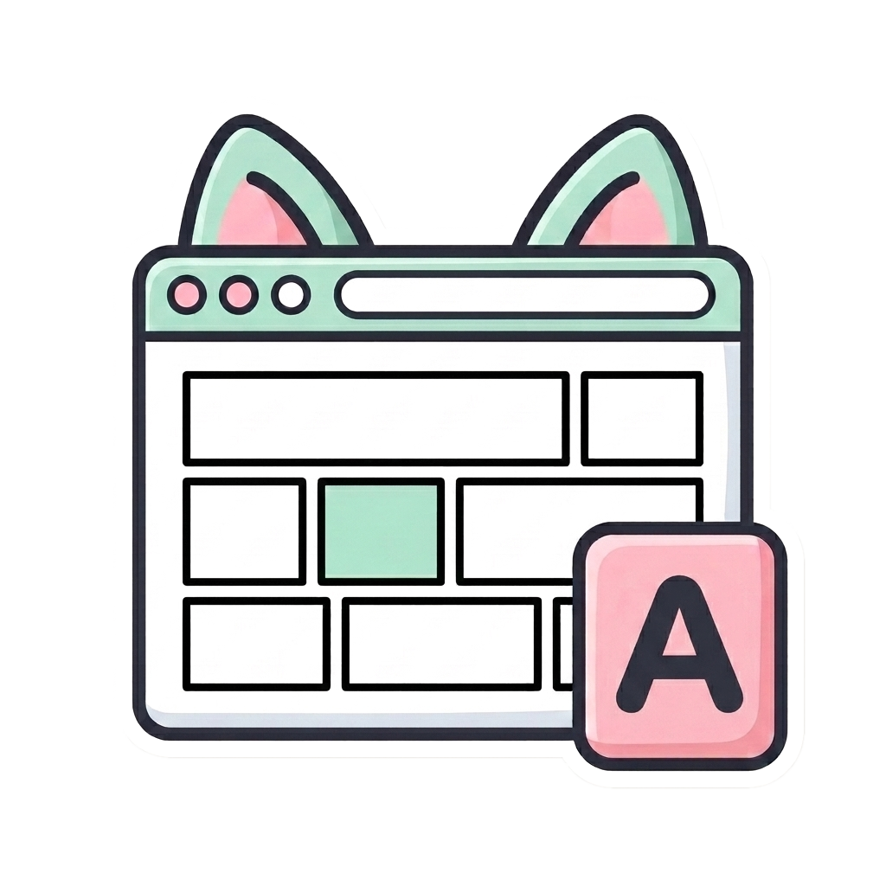
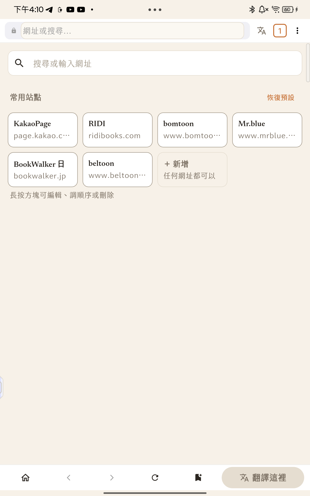
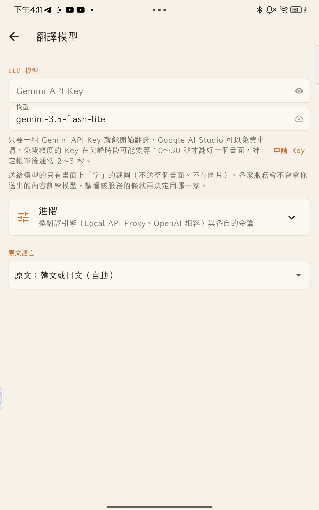
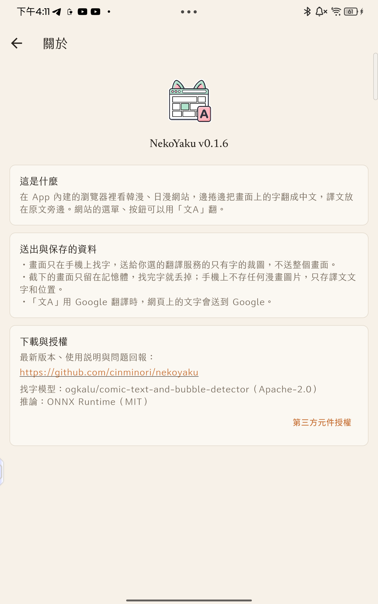

# NekoYaku

名字裡的 Yaku＝日文「訳」，翻譯的意思。

Android 漫畫網站翻譯瀏覽器：在內建瀏覽器裡看韓漫、日漫網站，邊捲邊把畫面上的字翻成繁體中文，譯文以旁註放在原文旁邊（日漫對話框可選擇直接蓋字）。

免費、無廣告、不收集資料。翻譯用你自己的 API Key。

## 下載

到 [Releases](../../releases/latest) 下載最新的 `NekoYaku-vX.Y.Z-arm64.apk`。

- 支援 Android 7.0 以上、arm64 裝置（近幾年的手機、平板、電子紙閱讀器都是）
- 安裝時系統會問「允許安裝未知來源的應用程式」，允許即可
- 更新時直接安裝新版 APK 覆蓋，設定與譯文都會保留

## 功能

- **捲到哪翻到哪**：按「翻譯這裡」後，每次捲動停下就翻畫面上新出現的字；換下一話接著翻
- **只送字的裁圖**：手機上用找字模型找出文字框，送給翻譯模型的只有字的裁圖，不送整個畫面；截圖只留在記憶體，用完就丟
- **連貫翻譯**：前情摘要＋最近 15 句前文；作品名詞表（人名、專有名詞自動收集，可手動改譯名）
- **翻過會記住**：每話只存譯文文字與位置（以網頁上的圖片為錨點），重開同一話直接貼回
- **日漫對話框蓋字**：日文對話框可以把譯文直排蓋進框裡，塞不下自動退回旁註（可在譯文選單關閉）
- **網頁介面翻譯（文A）**：用 Google 翻譯或輕量模型把網站選單、簡介翻成中文
- **翻譯模型**：Gemini、Claude（官方 API）、任何 OpenAI 相容端點（OpenRouter、自架 proxy…）
- **電子紙模式**：e-ink 裝置自動切換高對比、無動畫介面

  

## 開始使用

1. 到 [Google AI Studio](https://aistudio.google.com/apikey) 申請一組 Gemini API Key（免費）
2. 打開 NekoYaku → 右上角「⋮」→「設定」→ 貼上 Key
3. 從起始頁點一個站，登入你自己的帳號，打開一話漫畫
4. 按下方「翻譯這裡」，往下捲就會邊捲邊翻

## 翻譯速度與模型

免費額度的 Key 在尖峰時段排隊比較久，一個畫面可能要等 10～30 秒；綁定帳單（付費額度）後通常 2～3 秒。手機上找字約 1 秒，慢的部分都在等翻譯服務回應。

模型可以在「設定」→「翻譯模型」切換：

| 需求 | 建議模型 |
|---|---|
| 要快 | `gemini-3.5-flash-lite`（預設） |
| 要翻得比較精確 | `gemini-3.1-pro` 或 `gemini-4-argon` |

精確的模型每個畫面的 token 用量與費用高得多，免費額度也比較快用完，請自行斟酌費用與額度再選。

## 網站

起始頁預設放的常見站有實際測試過，找字與對話框偵測可以正常運作。其他網站也能直接輸入網址使用，但閱讀器的結構各站不同，找字與旁註定位不一定成功。

| 網站 | 狀態 |
|---|---|
| KakaoPage、RIDI、bomtoon、Mr.blue（韓） | 已實測 |
| BookWalker（日）直向捲動／翻頁模式、beltoon（日） | 已實測 |

App 不下載、不保存任何漫畫圖片，只是在你登入的網站上就地翻譯。

## 隱私

- 畫面只在手機上找字，送到翻譯服務的只有字的裁圖，不送整個畫面
- 截圖只留在記憶體，找完字就丟掉；手機上不存漫畫圖片，只存譯文文字與位置
- API Key 存在手機本機，不會送到作者這邊；App 沒有任何統計、追蹤或伺服器
- 「文A」用 Google 翻譯時，網頁上的文字會送到 Google

## 已知限制

- 免費 Key 偶爾會被翻譯服務擋下（429），稍等再按一次
- 橫向雙頁時旁註會互相推開，偶爾跑到隔壁格
- 雲朵狀、特殊形狀的對話框偶爾會被當成框外字
- 超大藝術字、狀聲詞不翻
- 系統 WebView 很舊（Chrome 99 以前，例如 Supernote Nomad 出廠韌體）的裝置：App 會自動把網站 CSS 整理成舊版看得懂的寫法，主要版面正常，個別元件可能略有差異

## 問題回報

到 [Issues](../../issues) 開一則，附上網站、裝置型號與螢幕截圖。

## 第三方元件

| 元件 | 用途 | 授權 |
|---|---|---|
| ogkalu/comic-text-and-bubble-detector（detector-v4-s，int8 ONNX） | 找字 | Apache-2.0 |
| ONNX Runtime | 裝置端推論 | MIT |
| jf open 粉圓 | 內文字型 | SIL OFL 1.1 |
| Newsreader | 標題字型 | SIL OFL 1.1 |

完整授權文字在 App 內「關於」→「第三方元件授權」。
